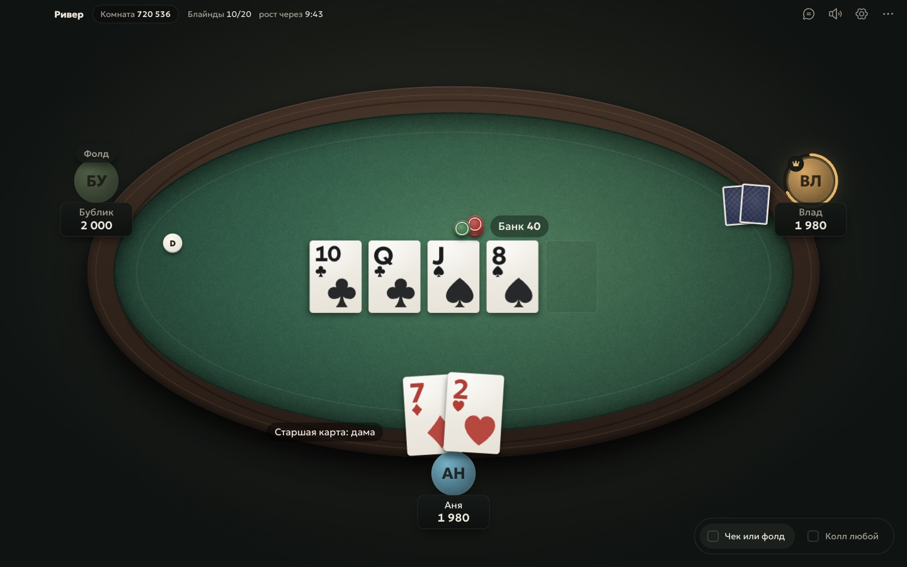

# Ривер

Техасский холдем (No-Limit) и блэкджек для своей компании. Один игрок создаёт игру, остальные заходят по шестизначному коду. Без регистрации и денег: только фишки и друзья.



## Скачать

Последняя версия лежит в [релизах](https://github.com/vldvr/river/releases/latest). Нужна Windows 10 или 11 либо macOS 12 и новее.

- **River-Setup-x.y.z.exe**: установщик. Ставится за пару секунд без прав администратора и сам обновляется, когда выходит новая версия. Лучше брать его.
- **River-x.y.z-portable.exe**: одна программа без установки. Сама не обновляется: новую версию надо скачать вручную.

### Windows пишет «Система Windows защитила ваш компьютер»

У программы нет платной подписи разработчика, поэтому SmartScreen её не узнаёт. Нажми «Подробнее», потом «Выполнить в любом случае». Это нужно один раз.

### Mac

- **River-x.y.z-mac-arm64.dmg**: для Mac на M1 и новее.
- **River-x.y.z-mac-x64.dmg**: для Mac на Intel.

Открой dmg и перетащи Ривер в «Программы». У программы нет подписи Apple, поэтому при первом запуске macOS её не откроет. Открой «Системные настройки → Конфиденциальность и безопасность», пролистай вниз и нажми «Всё равно открыть». Если macOS пишет, что программа повреждена, выполни в Терминале:

```bash
xattr -cr /Applications/River.app
```

На Mac игра сама не обновляется: новую версию скачивай из релизов.

## Как играть

1. Запусти Ривер и впиши имя. Можно выбрать цвет или поставить свою картинку.
2. Один из вас нажимает «Создать игру» и диктует остальным код комнаты, например `482 913`.
3. Остальные вводят код и нажимают «Войти».
4. Хост выбирает формат и нажимает «Начать игру».

**Форматы**
- Турнир: у всех одинаковый стек, блайнды растут по времени, игра идёт до одного победителя.
- Кэш-игра: блайнды не растут, после вылета можно докупиться, в конце видно, кто сколько выиграл.

В настройках партии можно задать, сколько раз вылетевший может войти снова: ни разу, от одного до трёх раз или без ограничений.

**Блэкджек.** До 7 игроков против дилера, которого ведёт программа хоста. Шуз из 6 колод, дилер добирает до 17 и стоит на мягких 17, блэкджек платит 3 к 2. Можно удвоить на первых двух картах и один раз разделить пару. Страховки нет. Каждый раунд сначала все делают ставки, потом ходят по очереди.

Свободные места можно занять ботами: удобно, если собралось мало людей.

### Управление

| Клавиша | Действие |
|---|---|
| F | Фолд |
| C | Чек или колл |
| R или Enter | Бет или рейз на выбранную сумму |
| H, S, D, P | Блэкджек: ещё, хватит, удвоить, разделить |
| Стрелки, колесо мыши | Изменить сумму ставки |
| T | Чат и история раздач |
| F11 | Полный экран |

Пока ход не твой, можно заранее отметить «Чек или фолд» или «Колл любой». Если свернуть окно, значок на панели задач мигнёт, когда подойдёт ход.

## Как это устроено

Игру считает компьютер хоста: раздаёт карты, следит за ставками и банками. Друзья подключаются к нему через небольшой сервер комнат `river.wkiseven.me`. Сервер только пересылает сообщения внутри комнаты и правил не знает. Его код лежит в папке [`server`](server).

Каждый игрок получает только свои карты, чужие видны лишь на вскрытии. Колода тасуется криптостойким генератором. Сама программа хоста карты знает, так что играйте с теми, кому доверяете.

Если у кого-то пропала связь, Ривер сам переподключит его на то же место, а пока за него делается чек или фолд. Если хост закрыл программу посреди партии, при следующем запуске на главном экране будет «Продолжить» с тем же кодом: партия откроется на паузе, друзья вернутся на свои места с теми же фишками, и хост снимет паузу.

## Если не подключается

- **«Комнаты нет»**: проверь код. Код живёт, пока у хоста открыта игра.
- **«Сервер игры не отвечает»**: проверь интернет. Если сервер недоступен, хост может открыть в лобби «Друзья не могут подключиться?» и включить вход по IP. Windows спросит про брандмауэр: нажми «Разрешить». Друзья нажимают «По IP» под полем кода и вводят показанный адрес.
- Вход по IP через интернет работает, только если роутер хоста открыл порт сам (игра пробует сделать это через UPnP). Если нет, проще всего поставить всем [Radmin VPN](https://www.radmin-vpn.com/ru/), зайти в одну сеть и войти по адресу Radmin.

## Для разработки

```bash
npm install
npm run dev        # приложение с горячей перезагрузкой
npm test           # движок, сервер хоста, сервер комнат
npm run typecheck
npm run pack:win   # установщик и portable в release/
```

Без Electron интерфейс открывается в браузере: `npm run web`. Несколько игроков в одном браузере: вкладки с `?profile=a`, `?profile=b`. Свой сервер комнат для тестов: `node server/relay.mjs` и `?relay=ws://127.0.0.1:8080/ws`.

Устройство кода:
- `src/engine`: правила холдема без интерфейса (торговля, банки, оценка рук, турнир и кэш).
- `src/host`: сервер партии, который крутится у хоста.
- `src/renderer`: интерфейс на React и Motion.
- `server`: ретранслятор комнат.

## Авторы ресурсов

Звуки: [Kenney](https://kenney.nl) (CC0). Шрифт: Geologica (SIL OFL). Иконки: Phosphor (MIT). Подробности в [resources/CREDITS.md](resources/CREDITS.md).
